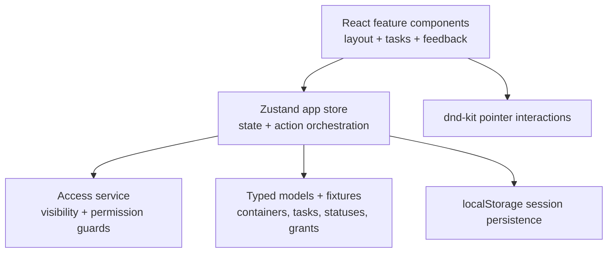

# Flowboard


Flowboard is a frontend-only project workspace built for the task-management take-home assignment. It is designed to feel like a small, professional productivity product rather than a static CRUD demo: users can navigate a permission-aware workspace hierarchy, switch between Kanban and list views, create and edit tasks, drag tasks between statuses, bulk-update selected tasks, and recover from simulated failures.

The interface uses a light orange visual system with accessible contrast, consistent spacing, standard Lucide icons, responsive layouts, drawers/modals, keyboard support, and explicit loading, empty, success, and error feedback.

## Run locally

Requirements: Node.js 18+ and npm.

```bash
npm install
npm run dev
```

Open the local URL printed by Vite. The remaining scripts are:

```bash
npm run test       # Vitest test suite
npm run build      # TypeScript check + production build
npm run lint       # ESLint
```

No backend, database, environment variables, or deployment configuration are required. The app runs entirely in the browser. Mutations are persisted to `localStorage`, so refreshes preserve the current demo session; resetting browser storage restores the fixtures.

## Product capabilities

- Workspace → space → folder → list navigation with dynamic breadcrumbs.
- Seeded Northstar Studio workspace with Engineering and Product spaces, folders, lists, statuses, users, grants, and realistic tasks.
- Board/Kanban view with visible drag previews, exact insertion drop targets, persisted status and ordering, and empty columns.
- List view with search, due-date/priority sorting, row selection, select-all, and bulk status/assignee updates.
- Task creation with title, description, status, priority, assignee, and due date in one flow.
- Task drawer for editing details, activity history, archive confirmation, Escape/overlay close, and focus-friendly controls.
- Admin-only hierarchy actions: create, rename, reorder, and cascading soft-archive spaces, folders, and lists.
- Permission-aware visibility and mutation guards for public/private containers and explicit allow/deny grants.
- Toasts and inline feedback for success, validation, permission, and simulated network failures.
- Responsive mobile sidebar drawer, stacked board columns, responsive forms, and horizontally scrollable dense tables.
- `Cmd/Ctrl + K` focuses task search.

## Assignment coverage

The core requirements and selected stretch goals are implemented in the current build:

| Assignment area             | Implementation                                                                                                                         |
| --------------------------- | -------------------------------------------------------------------------------------------------------------------------------------- |
| Workspace hierarchy         | Workspace → space → folder → list tree with breadcrumbs and active selection                                                           |
| Board and list views        | Toggleable Kanban/list views with persisted task changes and list sorting                                                              |
| Task management             | Create, edit, assign, prioritize, schedule, describe, archive, and bulk-update tasks                                                   |
| Permissions                 | Public/private visibility, allow/deny grants, member switching, and admin-only hierarchy actions                                       |
| Interaction quality         | Loading states, empty states, error toasts, hover/focus/active states, confirmations, and drop-target feedback                         |
| Keyboard controls           | `Cmd/Ctrl + K` search shortcut and `Escape` to close dialogs/drawers                                                                   |
| Responsive UX               | Mobile navigation drawer, stacked board columns, responsive forms, compact top bar, and dense-table scrolling                          |
| Drag and drop               | Visible insertion preview, highlighted drop target, status/position persistence, and empty-column handling                             |
| Nice-to-have: search        | Client-side task title/description search with keyboard focus shortcut                                                                 |
| Nice-to-have: activity      | Task activity section records task updates and archive events                                                                          |
| Nice-to-have: bulk actions  | Multi-select tasks and update status or assignee in one action                                                                         |
| Nice-to-have: sorting       | Sort list view by due date or priority in ascending/descending order                                                                   |
| Nice-to-have: robust states | Deterministic simulated failures, permission errors, validation feedback, and recovery-safe state updates                              |
| Nice-to-have: polished UI   | Consistent spacing, standard Lucide icons, light-orange theme, responsive behavior, modals, drawer editing, and card/drop interactions |

The implementation deliberately does not expose inactive placeholder controls. Every visible control has a meaningful behavior, while failure simulation remains a store/test capability so reviewers can verify unhappy paths without introducing a demo-only settings panel.

## Architecture

The implementation uses an MVC-inspired feature architecture. React components render views and emit user events; the Zustand store coordinates application state and actions; typed models and services contain domain rules and access decisions.



Important boundaries:

| Area                     | Responsibility                                                         |
| ------------------------ | ---------------------------------------------------------------------- |
| `src/features/layout`    | Responsive sidebar, hierarchy tree, top bar, user switcher             |
| `src/features/tasks`     | Board, list, task cards, create dialog, task drawer                    |
| `src/components`         | Shared loading, toast, and task presentation helpers                   |
| `src/models`             | Domain types and deterministic seed data                               |
| `src/services/access.ts` | Centralized container access rules                                     |
| `src/stores/appStore.ts` | State, selectors, mutation validation, persistence, failure simulation |
| `src/tests`              | Access, mutation, hierarchy, and interaction regression tests          |

`App.tsx` is intentionally a composition layer. Feature behavior lives in focused components and store/service modules rather than one large page component.

## Data model

The state is normalized around these entities:

- **Workspace/container:** a workspace, space, folder, or list. Containers use `parentId`, `type`, `position`, `visibility`, and nullable `archivedAt` for hierarchy and soft archive semantics.
- **Task:** belongs to a primary list, references a status, stores title/description/priority/due date, and contains assignee IDs.
- **Status:** belongs to one list and has an ordered position and presentation color.
- **User:** has identity, initials, color, and role (`admin` or `member`).
- **Grant:** associates a user with a container using `allow` or `deny` mode.

Selectors derive the accessible lists, current container path, visible tasks, and status groups. Store actions validate relationships before writing, including ensuring a task status belongs to its list.

## Client-side permissions

Permissions are enforced in the store and access service, not only by hiding buttons:

1. The current user is resolved from the user switcher.
2. Explicit deny grants take precedence.
3. Private containers require an explicit allow grant.
4. Public containers are available unless denied.
5. Admin-only hierarchy mutations and protected workspace operations are rejected by the same domain action layer.

Failed operations return a typed error result and display feedback without corrupting the current state. The seeded users make this behavior easy to review by switching between Alice (admin), Bob, and Carol.

## Interaction and UX decisions

- Loading state is shown on initial load and view/list transitions.
- Empty list and empty Kanban columns explain what the user can do next.
- Mutation failures produce clear toast messages; simulated failures are deterministic and testable rather than exposed as a distracting product setting.
- Archive is a soft archive with confirmation. Archived containers/tasks leave active views but remain represented in state for recovery semantics.
- Dialogs and drawers close through Escape, close buttons, and overlay click where appropriate.
- Hover, focus, active, disabled, drop-target, and selected states are explicit.
- Task descriptions have bounded rows and internal scrolling so long content cannot break the drawer layout.
- Board drag uses insertion slots instead of ambiguous column-only drops. The app does not use a `style` prop to position dragged elements; dnd-kit owns pointer interaction and the drop slots own visual feedback.

## Testing

The suite currently contains 13 passing tests covering:

- Public/private visibility and explicit grants.
- Denied mutations and admin-only behavior.
- Task status/list integrity.
- Deterministic simulated mutation failure behavior.
- Alice-to-Bob user switching.
- Container creation, rename, reorder, cascading archive, and selection fallback.

Run the checks with:

```bash
npm run test
npm run build
```

## Trade-offs and next steps

This submission intentionally keeps the data layer local so the complete interaction model can be reviewed without a backend. The main trade-offs are:

- `localStorage` persistence is convenient for a take-home but is not a substitute for server synchronization, authentication, or conflict resolution.
- The board renders the current fixture-sized set directly. For very large workspaces, I would add virtualization after measuring real list sizes and preserving keyboard/DnD semantics.
- Soft archive exists in the model and active UI, while a production product would add a dedicated archive view and restore flow.
- Failure simulation is available to the store and tests but is not exposed as a user-facing demo control.

With another iteration I would add a real API adapter with optimistic updates and retry, server-side search/pagination, full container/status settings, an archive/restore surface, richer keyboard drag-and-drop, and end-to-end browser tests across responsive breakpoints.

## Deployment

The app is a static Vite build and can be deployed to Vercel without a backend:

```bash
npm run build
```

In Vercel, select the project root, use `npm run build` as the build command, and use `dist` as the output directory. No environment variables are required for the current frontend-only implementation.

## AI usage log

AI assistance was used for initial scaffolding, implementation acceleration, test drafting, code search, and review of responsive/UI details. The implementation was then directed and corrected through manual product review against the assignment: the large initial page was split into feature components; non-functional controls were removed; filters/sorting, bulk updates, task creation fields, modal/drawer behavior, loading/empty/error feedback, drag insertion targets, permission checks, consistent iconography, and responsive behavior were added or refined. Final architecture decisions, claims in this README, and test/build verification were reviewed against the actual source code.

See [AI_USAGE.md](./AI_USAGE.md) for the detailed prompt, correction, and rejected-output log.
